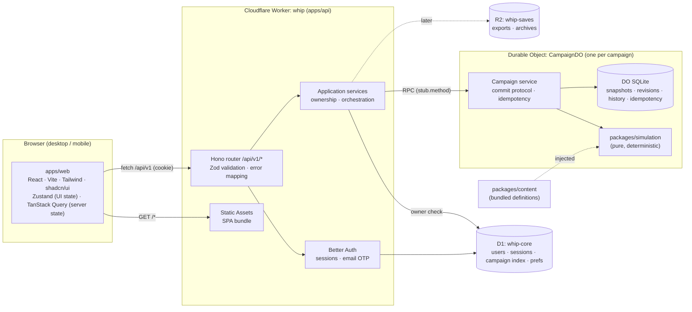

# 01 — System Architecture Overview

Status: **Accepted** (approved 2026-10-24)

WHIP is a **modular monolith**: one Cloudflare Worker serves the React SPA and the versioned API.
It talks to one D1 database (accounts and the campaign index) and one SQLite-backed Durable Object per
campaign (canonical state and history). R2 holds exports and archives. All game rules live in a pure
TypeScript package that knows nothing about Cloudflare.

## 1. Diagram



Request path for "advance week": browser → Worker (session cookie → user) → D1 ownership check →
`CampaignDO.advance({ expectedRevision, idempotencyKey })` → simulation runs in-memory inside the DO →
atomic SQLite commit → D1 index projection update → response DTO.

## 2. Package structure and dependency rules

```text
whip/
  apps/
    web/            React SPA (Vite). Depends on: contracts, ui, domain (types only)
    api/            Worker + CampaignDO + D1 schema/migrations (Drizzle) + wrangler.jsonc
                    Depends on: simulation, domain, contracts, content
  packages/
    domain/         Entity types, ID brands, invariants, Zod schemas for state. Depends on: zod
    simulation/     Pure engine: RNG, phases, actions, AI, selectors, state migrations. Depends on: domain
    content/        Scenario, traits, offices, issues, event definitions (data + Zod validation). Depends on: domain
    contracts/      API request/response Zod schemas + DTO types + error codes. Depends on: domain (types)
    ui/             Design tokens, shadcn-derived primitives, WHIP components. Depends on: react
    config/         Shared tsconfig bases, ESLint flat config, Prettier config
  infrastructure/
    cloudflare/     Provisioning notes/scripts (create D1/R2, secrets list), environment matrix
  docs/
    architecture/   This set of documents
    decisions/      ADRs
  tests/
    integration/    End-to-end API tests running in workerd (@cloudflare/vitest-plugin)
```

Allowed dependency direction (CI checks it with `dependency-cruiser`):

```
domain ← content
domain ← simulation
domain ← contracts
{simulation, content, contracts, domain} ← api
{contracts, ui, domain(types)} ← web
```

`simulation` does **not** import `content`. Content is injected via `SimulationContext`, so the engine
can be tested with fixture content and content can be swapped per scenario.

**Deviations from the suggested layout**
1. `wrangler.jsonc`, D1 migrations and the Durable Object class live in `apps/api`, not
   `infrastructure/cloudflare`. Wrangler, the Vite plugin and the Vitest plugin all resolve config
   relative to the Worker, and splitting them makes local dev brittle. `infrastructure/cloudflare` keeps
   provisioning docs and scripts.
2. There is no separate `db` package. Only `apps/api` touches persistence.
3. The web app is not deployed as its own Worker or Pages project. It is built to `apps/web/dist` and
   served by the API Worker's Static Assets binding, which gives one origin, no CORS and first-party
   cookies.

## 3. Simulation execution location

The simulation runs **server-side inside the Campaign Durable Object**. The client never runs
authoritative rules. Because `packages/simulation` is pure, the client *could* later import selectors or
run what-if previews (e.g. "projected vote count"), but results the server persists are always computed
by the server.

## 4. Environments and deployment topology

| Env | Worker | D1 | R2 | DO namespace | Access |
|---|---|---|---|---|---|
| local | `wrangler dev` / `vite dev` (workerd) | local SQLite | local | local | Dev identity header enabled |
| staging | `whip-staging` (workers.dev) | `whip-core-staging` | `whip-saves-staging` | separate | Behind **Cloudflare Access** |
| production | `whip` (custom domain) | `whip-core` | `whip-saves` | separate | Public, Better Auth |

GitHub Actions: on PR → typecheck, lint, unit tests, integration tests, build. On `main` → deploy
to staging (apply D1 migrations, then `wrangler deploy --env staging`). Production deploy needs a
manual approval (GitHub environment protection).

**Plan requirement:** Workers **Paid** ($5/month). The Free plan's 10 ms CPU limit cannot run a weekly
turn or hash a password.

## 5. Document index

- [02 — Domain model](02-domain-model.md)
- [03 — Simulation engine](03-simulation-engine.md)
- [04 — Persistence](04-persistence.md)
- [05 — API, auth and frontend](05-api-auth-frontend.md)
- [06 — Milestones, risks and open questions](06-milestones-risks.md)
- ADRs: [`docs/decisions/`](../decisions/)
