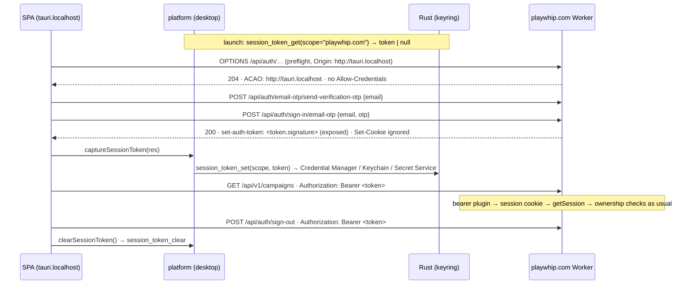

# 08 — Desktop client (Tauri v2)

Status: **Proposed** (ADR-0011). Built and verified locally on Windows 11, 2026-10-24.

The desktop client runs the same React SPA inside a Tauri v2 window and plays against the same cloud
API at `https://playwhip.com`. There is no local simulation or database: campaigns stay
server-authoritative in Durable Objects (ADR-0003/0005). The Rust host only adds what a browser
can't do: an OS credential store, fullscreen, a single instance, window-state memory and signed
self-updates.

## 1. Architecture

```text
apps/desktop/                       @whip/desktop
  package.json                      tauri CLI, build:web, dev:web, icons, version:bump/check
  scripts/version.mjs               keeps tauri.conf.json ⇄ package.json ⇄ Cargo.toml versions in sync
  dist/                             (built) the SPA in `desktop` mode — tauri frontendDist
  src-tauri/
    tauri.conf.json                 window, CSP, bundle targets, updater pubkey + endpoint
    capabilities/default.json       core + fullscreen + updater + process(exit, restart)
    src/lib.rs                      plugins, commands, hidden-until-ready window
    src/session.rs                  session_token_get/set/clear → keyring (OS credential store)
    src/shell.js                    injected before the SPA: F11/Alt+Enter, show-on-boot-ready,
                                    release-only blocking of browser keys / context menu / ctrl-zoom
    icons/                          generated: `pnpm --filter @whip/desktop icons` (docs/brand/Whip-Icon.svg)

apps/web/src/platform/              platform adapter (web + desktop), see §5
apps/web/.env.desktop               VITE_API_BASE=https://playwhip.com (packaged build)
apps/web/.env.desktop-dev           VITE_API_BASE= (tauri dev → Vite proxy → wrangler dev)
```

| Concern | How |
|---|---|
| Window | Title "WHIP", 1600×900 default, **min 1280×720**, starts **maximized**, `backgroundColor #0F1D1C`, created **hidden** and shown on `whip:boot-ready` (3 s fallback in both JS and Rust) |
| Size/position memory | `tauri-plugin-window-state` (all flags except `VISIBLE`) |
| Fullscreen | **F11 / Alt+Enter** (shell.js → `toggle_fullscreen` command); `platform.toggleFullscreen()` for menus |
| Single instance | `tauri-plugin-single-instance` (registered first). A second launch focuses the running game |
| Quit | `platform.quit()` → `process.exit(0)` |
| Browser chrome | Release builds: no devtools (Tauri default), no context menu outside text fields, F5/Ctrl+R/P/F/U/J/+/-/0, F12, Alt+←/→ blocked, `zoomHotkeysEnabled: false`, Ctrl+wheel blocked |
| Audio autoplay | Windows: `additionalBrowserArgs` adds `--autoplay-policy=no-user-gesture-required` (see §6) |
| CSP | `default-src 'self'`; `connect-src 'self' ipc: http://ipc.localhost https://playwhip.com https://*.workers.dev http://localhost:8787 http://127.0.0.1:8787`; styles allow `'unsafe-inline'` (React style props) |
| Identity | product "WHIP", binary `WHIP.exe`, identifier `com.cheatcodemedia.whip` |
| Bundles | Windows **NSIS per-user** (no admin, WebView2 bootstrapper if missing); macOS universal `.app` + `.dmg` (min 11.0); Linux AppImage + deb. MSI is a one-word change (`"targets"` + `--bundles msi`), but it installs per-machine (admin), and having two Windows formats in the release manifest complicates updates, so it is off |

Origins: the bundled SPA is served from `http://tauri.localhost` (Windows/WebView2) or
`tauri://localhost` (macOS WKWebView, Linux WebKitGTK). Both are cross-site to playwhip.com.

## 2. Auth flow (bearer sessions)

The browser keeps HttpOnly `SameSite=Lax` cookies (ADR-0002). The desktop client can't use them
because they are cross-site, so it uses the **same Better Auth session as a bearer token**
(`bearer({ requireSignature: true })` plugin).



Server side (apps/api):

- `infrastructure/auth/trusted-origins.ts`: `DESKTOP_ORIGINS` (`http://tauri.localhost`,
  `https://tauri.localhost`, `tauri://localhost`), plus `LOCAL_DEV_ORIGINS` (`localhost:5173`,
  `127.0.0.1:5173`, `localhost:1420`) **only when `ENVIRONMENT=local`**.
- `better-auth.ts`: `bearer({ requireSignature: true })`; those origins are added to `trustedOrigins`,
  so Better Auth's Origin / Fetch-Metadata CSRF checks accept the desktop sign-in and reject others.
- `http/middleware/cors.ts` on `/api/*`: the origins above only. Allowed request headers:
  `Authorization, Content-Type, Idempotency-Key, If-None-Match` (+ `X-Whip-Dev-User` locally).
  Exposed headers: `set-auth-token, ETag`. Max-age 600. **No credentials.** Unknown origins get no
  `Access-Control-Allow-Origin`. The browser SPA is same-origin and unaffected.
- `requireUser` is unchanged: `auth.api.getSession({ headers })` runs the bearer plugin's hook, so
  every route (and the campaign ownership check) works for both transports.
- Tests: `apps/api/src/http/middleware/cors.test.ts` (unit) and
  `tests/integration/test/desktop-auth.fake.test.ts` (workerd). They cover preflight grant and
  denial, cross-site sign-in from an untrusted origin → 403, OTP sign-in → `set-auth-token`, bearer
  on `/me`, create and read a campaign, 404 for another player's campaign, sign-out revocation,
  and tampered, unsigned and `Basic` tokens → 401.

Token storage: Rust `keyring` 4 (`v1` feature), service `com.cheatcodemedia.whip`, account
`session@<api host>`. Staging and local builds therefore never read the production token. If the
store fails (e.g. Linux without a Secret Service daemon), the platform keeps the token in memory
for that launch only and never writes it to localStorage.

## 3. Update flow

```text
launch ─▶ UpdatePrompt / useDesktopUpdate()
           ├─ platform.checkForUpdates()  → plugin-updater: GET playwhip.com/api/v1/desktop/update/
           │                                {target}/{arch}/{current_version} → 200 JSON | 204
           │                                (bundle minisign-verified against the pubkey in tauri.conf.json)
           └─ checkCompatibility()        → GET /api/v1/health {apiVersion, minDesktopVersion}
   ├─ too old (app < minDesktopVersion) or API major ≠ 1 ─▶ blocking "UPDATE REQUIRED" overlay
   ├─ newer build ─▶ corner card "Update available — v0.2.0 · [RESTART TO UPDATE] [LATER]"
   └─ nothing / offline / no release yet ─▶ silent (never blocks play)
RESTART TO UPDATE ─▶ downloadAndInstall (progress bar) ─▶ Windows: NSIS passive install restarts
                     the app · macOS/Linux: process.relaunch()
```

- `GET /api/v1/health` now returns `apiVersion` (`API_VERSION = '1.1.0'` in
  `apps/api/src/http/routes/health.ts`) and `minDesktopVersion` when the optional Worker var
  `MIN_DESKTOP_VERSION` is set (e.g. `"0.2.0"`; malformed values are ignored). In
  `@whip/contracts` both fields are **optional** (an additive change that keeps old fixtures and
  servers valid).
- Rule: keep `/api/v1` changes additive. Before a breaking change ships, release a desktop
  build that handles it, then raise `MIN_DESKTOP_VERSION`.
- Endpoint: `https://playwhip.com/api/v1/desktop/update/{{target}}/{{arch}}/{{current_version}}`
  (Tauri's dynamic-server form; §4). It replaced GitHub Releases (2026-10-25) because the repo is
  private, so release assets need auth. **Builds made before that change (the local 0.1.0
  `WHIP_0.1.0_x64-setup.exe` from 2026-10-24) still point at GitHub and can never self-update —
  rebuild before the first real release.** The Rust updater makes the request, not the webview,
  so CORS and the CSP `connect-src` don't apply to it (the bundle download is also Rust).

### Signing key

- Private key: `%USERPROFILE%\.tauri\whip-updater.key` (minisign key ID D08055D946FC8E2D, rotated 2026-10-25, password-protected). Password:
  `whip-updater.key.password`. Warning file: `whip-updater.key.WARNING.txt`. **None of these
  are in the repo.** Back the key up: if it is lost, installed clients can never verify another
  update.
- GitHub Actions secrets on PhilCCMG/whip: `TAURI_SIGNING_PRIVATE_KEY`,
  `TAURI_SIGNING_PRIVATE_KEY_PASSWORD`.
- The public key is committed in `apps/desktop/src-tauri/tauri.conf.json` → `plugins.updater.pubkey`.
- A local `tauri build` needs the two env vars, because `createUpdaterArtifacts` is on:

  ```sh
  TAURI_SIGNING_PRIVATE_KEY="$(cat ~/.tauri/whip-updater.key)" \
  TAURI_SIGNING_PRIVATE_KEY_PASSWORD="$(cat ~/.tauri/whip-updater.key.password)" \
  pnpm --filter @whip/desktop tauri build --bundles nsis
  ```

## 4. Distribution and release process

Installers and updates are served from **Cloudflare R2** through the production Worker. Nothing
depends on GitHub Releases (the repo is private).

### R2 layout (bucket `whip-releases`, binding `RELEASES`)

| Key | Written by | Notes |
|---|---|---|
| `desktop/releases/{version}/{file}` | release workflow / local script | NSIS `.exe`, `.dmg`, `.app.tar.gz`, `.AppImage`, `.deb` + `.sig`. **Immutable**: the script refuses to publish a version whose manifest exists |
| `desktop/releases/{version}/manifest.json` | same, uploaded **last** | `{ version, notes, pub_date, platforms: { "windows-x86_64" \| "darwin-aarch64" \| "darwin-x86_64" \| "linux-x86_64": { url_path, signature, installer_path } } }`. Paths are file names in the version directory; `signature` is the `.sig` contents. macOS is universal, so both darwin keys name the same files. Schema: `DesktopReleaseManifestSchema` (`@whip/contracts`) |
| `desktop/channels/stable.json` | promote workflow only | `{ version, promotedAt }`. **A release is live only while the channel points at it** |

Local/tests bind `whip-releases-local` (never created remotely). Staging has **no** `RELEASES`
binding (binding a missing bucket fails `wrangler deploy`), so there the routes answer 204/404.

### Worker routes (`apps/api/src/http/routes/desktop.ts`, unauthenticated)

| Route | Answer |
|---|---|
| `GET /api/v1/desktop/update/:target/:arch/:currentVersion[?channel=stable]` | channel → manifest; if newer than `currentVersion` (SemVer, pre-releases rank lower) **and** `{target}-{arch}` is in the manifest: 200 `{ version, notes, pub_date, url, signature }` with `url` = `https://playwhip.com/api/v1/desktop/files/{version}/{url_path}`. Otherwise **204** (also unknown platform, no channel, corrupt/missing manifest — logged). Malformed version or channel → 400 envelope. `Cache-Control: public, max-age=60` |
| `GET /api/v1/desktop/files/:version/:filename` | streams the R2 object: `Content-Type`, `Content-Length`, `ETag` (+ `If-None-Match` → 304), single `Range` → 206/416, `Content-Disposition: attachment`, `public, max-age=31536000, immutable`. Strict regexes for both params (no `/`, `%`, `..`), so nothing outside `desktop/releases/` is reachable. Unpromoted versions are downloadable by exact URL (useful for smoke tests) |
| `GET /download[?os=windows\|mac\|linux]` | 302 to the stable installer for the User-Agent's OS (NSIS `.exe` / `.dmg` / `.AppImage`); unknown OS (phones, curl) or no build for it → a minimal HTML link list; no release yet → 302 `/`. `no-store` |
| `GET /download/latest.json` | `{ version, downloads: { windows, mac, linux } }` (absolute URLs or null) for a future download page. `public, max-age=60` |

`/download` and `/download/*` are in `assets.run_worker_first` so the SPA fallback never swallows
them (an SPA page at `/download` would be shadowed by the Worker). Updater requests come from
Rust, so CORS is irrelevant to them; the `/api/*` CORS middleware still applies as usual.

### Releasing

1. `pnpm --filter @whip/desktop version:bump 0.2.0` (or `patch|minor|major`). This updates
   tauri.conf.json (the source of truth), package.json and Cargo.toml. Commit.
2. `git tag desktop-v0.2.0 && git push origin desktop-v0.2.0` (or run **Desktop release**
   manually and pick the platforms).
3. `.github/workflows/desktop-release.yml`: `plan` picks the matrix → `build` (one job per
   platform: tag check, `tauri build` with the signing secrets, artifacts collected) → `upload`
   (downloads all artifacts and runs `node scripts/desktop-release.mjs publish`, which builds
   `manifest.json` from the files and `.sig`s and uploads everything with
   `wrangler r2 object put --remote`). `fail-fast` means a failed platform uploads nothing. The
   channel is **not** touched: the release lands unpublished.
4. Smoke-test via `https://playwhip.com/api/v1/desktop/files/0.2.0/<installer>`.
5. **Desktop promote** workflow (`desktop-promote.yml`, inputs `version`, `channel=stable`,
   environment `production` → required reviewer): checks the manifest in R2, HEADs every file it
   names through the production Worker, then writes `desktop/channels/stable.json`. Clients see it
   on their next launch (≤ 60 s cache).

**Rollback**: promote the previous version. That stops the bad version reaching anyone else, but
Tauri **never downgrades**: clients already on it stay there until a newer version ships. Fix
forward with a higher version number.

**Matrix and cost** (private repo, per-minute multipliers: Linux 1×, Windows 2×, macOS **10×**):
manual runs choose `windows` (default) / `windows+linux` / `all`; tags build the repo variable
`DESKTOP_TAG_PLATFORMS` (default `all`). A cold Rust release build is roughly 10–15 min, so a
full tag costs on the order of 15×1 + 15×2 + 15×10 ≈ 200 billed minutes (the free 2,000/month
covers ~10 full releases); Windows-only ≈ 30. Set `DESKTOP_TAG_PLATFORMS=windows` until macOS
players exist. A platform missing from a release just gets 204 from the update route.

**First release from this machine** (Windows only, no CI):

```sh
# rebuild first (the existing 0.1.0 build predates the R2 endpoint), with the signing env vars (§3)
pnpm --filter @whip/desktop tauri build --bundles nsis
pnpm desktop:release:local --dry-run    # prints keys, sizes and manifest.json
pnpm desktop:release:local              # uploads with your `wrangler login`
pnpm desktop:release promote --version 0.1.0 --verify-base https://playwhip.com  # go live (Worker must be deployed)
```

CI (`ci.yml`, job `desktop`) runs a cheap gate on every PR: version sync, desktop-mode SPA build,
`cargo clippy -D warnings`, `cargo test` on ubuntu-22.04. It never bundles.

## 5. Platform adapter (`apps/web/src/platform/`)

| Export | Web | Desktop |
|---|---|---|
| `getPlatform()` | `createWebPlatform()` | `createDesktopPlatform(window.__TAURI__)`, loaded only when `MODE` is `desktop`/`desktop-dev` (static, so the web bundle drops it) |
| `isDesktop`, `kind` | false, `web` | true, `desktop` |
| `apiBase` / `apiUrl(path)` | `''` (same origin) | `VITE_API_BASE` (`https://playwhip.com`) |
| `fetchCredentials` | `include` | `omit` (bearer only; the API sends no Allow-Credentials) |
| `getAuthHeaders()` | `{}` | `{ Authorization: 'Bearer …' }` when signed in (synchronous, from memory) |
| `captureSessionToken(res)` / `setSessionToken` / `clearSessionToken` / `hasSessionToken` | no-ops / false | OS credential store |
| `quit()` | no-op | exit |
| `toggleFullscreen()` | Fullscreen API | window fullscreen |
| `appVersion` | null | `0.1.0` |
| `checkForUpdates()` | null | `AvailableUpdate { version, notes, install(onProgress) }` |
| `signalBootReady()` | harmless | shows the hidden window |
| `useDesktopUpdate()`, `<UpdatePrompt />` | renders nothing | update / update-required UI |
| `checkCompatibility()`, `compareVersions()` | | health-based gating |

The desktop implementation uses Tauri's injected globals (`app.withGlobalTauri: true`, which
also injects the updater and process plugin APIs as non-enumerable properties). It does not use
the `@tauri-apps/*` npm packages, so apps/web has no new dependencies. `tauri-bridge.ts` types the
small slice we use. If the architect prefers the npm packages, add `@tauri-apps/api@2.12.4`,
`@tauri-apps/plugin-updater@2.14.0` and `@tauri-apps/plugin-process@2.4.0` to apps/web and swap
`getTauriBridge()` for imports. Nothing else changes.

Tests: `platform.test.ts` (token headers, config, web impl, desktop impl against a fake bridge
including credential-store failure and update progress, compatibility) and `update-prompt.test.tsx`.

## Integration

**Applied (2026-10-25).** Where each item lives:

- `api/runtime.ts`: `baseUrl` and `platform: getPlatform`.
- `api/client.ts`: credentials and bearer headers; on a 401 with a stored token it clears the token and fires `whip:session-expired`.
- `api/auth.ts`: API origin, `captureSessionToken` on success, and sign-out always clears the token.
- `app.tsx`: `<UpdatePrompt/>` inside `BootGate`, plus `SessionExpiredRedirect` (→ `/?screen=signin`).
- `features/main-menu/main-menu.tsx` and `quit-confirm.tsx`: QUIT is the last item, on desktop only, with an in-menu red confirm ("Keep playing" focused, Esc cancels). The HUD shows `v<appVersion>` on desktop.

End-to-end verification of the debug build against local `wrangler dev` (`VITE_API_BASE=http://localhost:8787`):

- Music played before any input.
- OTP sign-in worked, and the token was saved to Credential Manager.
- Created a career and ended a week (turn 2).
- QUIT exited the process.
- After a relaunch the player was still signed in, and Continue showed "Week 2".

The list below is kept as the reference.

1. **`src/api/runtime.ts`**: point the client at the API origin:
   ```ts
   import { apiBase } from '../platform';
   export const api = createApiClient({ fetch: resolveFetch, baseUrl: `${apiBase}/api/v1`, devUser: … });
   ```
2. **`src/api/client.ts` `send()`**: platform credentials and auth headers on every request, and drop
   a dead token on 401:
   ```ts
   const platform = await getPlatform();
   const headers = new Headers(init.headers);
   for (const [k, v] of Object.entries(platform.getAuthHeaders())) headers.set(k, v);
   const res = await doFetch(url, { ...init, credentials: platform.fetchCredentials, headers });
   if (res.status === 401 && platform.hasSessionToken()) await platform.clearSessionToken();
   ```
   Keep `credentials: 'include'` as the web value (it is `platform.fetchCredentials` there). Don't
   send `X-Whip-Dev-User` from desktop production builds (`.env.desktop` already blanks
   `VITE_DEV_USER`).
3. **Sign-in screen**: every `/api/auth/*` call uses `apiUrl('/api/auth/…')` and
   `credentials: platform.fetchCredentials`. After a successful `POST /api/auth/sign-in/email-otp`,
   call `await platform.captureSessionToken(res)`. If it uses `better-auth/client`:
   ```ts
   createAuthClient({
     baseURL: apiBase || window.location.origin, basePath: '/api/auth',
     fetchOptions: {
       credentials: platform.fetchCredentials,
       auth: { type: 'Bearer', token: () => platform.getAuthHeaders().Authorization?.slice(7) ?? '' },
       onSuccess: ({ response }) => void platform.captureSessionToken(response),
     },
   });
   ```
   On desktop, `!platform.hasSessionToken()` at boot means signed out, so go straight to sign-in.
4. **Sign-out**: `POST /api/auth/sign-out` with `platform.getAuthHeaders()`, then
   `await platform.clearSessionToken()` and clear the TanStack Query cache.
5. **Main menu** (`src/features/main-menu/`): add a **QUIT** item when `platform.isDesktop` →
   `platform.quit()`. Optionally add a **Fullscreen** toggle (`platform.toggleFullscreen()`), a
   **Check for updates** item sharing one `useDesktopUpdate()` controller
   (`<UpdatePrompt controller={u} />`, `u.check()`), and a version label from `platform.appVersion`.
6. **`src/app.tsx`**: mount `<UpdatePrompt />` once at the root, above the router outlet.
7. **Boot sequence**: call `signalBootReady()` from `src/platform` (it dispatches the `window`
   event `whip:boot-ready` after two animation frames) when the CheatCode Media studio splash
   first renders. The desktop window stays hidden until then (3 s fallback), so no blank frame
   shows.
8. **Main-menu music**: on Windows, autoplay without a gesture is allowed (§6). Still (re)start or
   resume the `AudioContext` on the **PRESS ANY KEY** gesture, because macOS and Linux webviews
   (and browsers) may require one.

No `vite.config.ts` or `package.json` change is needed in apps/web. The desktop build uses
`vite build --mode desktop --outDir ../desktop/dist` via `pnpm --filter @whip/web exec`.

## 6. Boot window and audio autoplay

- **Hidden until painted**: `"visible": false` in tauri.conf.json. shell.js listens for
  `whip:boot-ready` and invokes `show_main_window`, with a 3 s `setTimeout` fallback. lib.rs has a
  second 3 s fallback thread that covers a page that never loads. The window keeps
  `backgroundColor #0F1D1C`, and window-state never restores visibility. Verified: with no event
  dispatched (the current web build), the window appears maximized after about 3 s.
- **Autoplay**: Tauri 2.12 does not expose wry's `autoplay` attribute. On **Windows** we set
  `app.windows[0].additionalBrowserArgs` to
  `--disable-features=msWebOOUI,msPdfOOUI,msSmartScreenProtection --autoplay-policy=no-user-gesture-required`.
  Setting this key **replaces** wry's default args, so the first part repeats wry 0.57's defaults
  (`wry/src/webview2/mod.rs`); recheck them when upgrading Tauri. A
  `WEBVIEW2_ADDITIONAL_BROWSER_ARGUMENTS` env var overrides both (that is how we attach the
  debugger, below). **macOS** (WKWebView) and **Linux** (WebKitGTK, default policy "allow
  without sound") get no equivalent from Tauri config. macOS behaviour is unverified, and Linux
  will block audible autoplay. Hence Integration item 8: start the music on the PRESS ANY KEY
  gesture. A native fix would need `with_webview` + `WKWebViewConfiguration` /
  `WebsitePolicies`, which is not worth it given that the title screen needs a key press anyway.

## 7. Development

| Command | What |
|---|---|
| `pnpm --filter @whip/desktop dev` | `tauri dev`: Vite (`--mode desktop-dev`) on :5173 inside the Tauri window, API same-origin via the Vite proxy to `wrangler dev` :8787. Run `pnpm dev` (or the api dev script) first. Debug build: devtools on, browser keys not blocked |
| `pnpm --filter @whip/desktop build:web` | SPA only, desktop mode → `apps/desktop/dist` |
| `pnpm --filter @whip/desktop tauri build --bundles nsis` | Release build + signed NSIS installer (needs the signing env vars, §3) |
| `pnpm --filter @whip/desktop tauri build --debug --bundles nsis` | Bundled SPA against `VITE_API_BASE` with devtools: the way to test against production or staging from the real `tauri.localhost` origin |
| `pnpm --filter @whip/desktop icons` | Regenerate icons from `docs/brand/Whip-Icon.svg` (then delete the generated `android/`, `ios/`, `Square*`, `StoreLogo`) |
| API override | `apps/web/.env.desktop.local`: `VITE_API_BASE=https://whip-staging.<acct>.workers.dev` or `http://localhost:8787`. The CSP `connect-src` already allows `*.workers.dev` and localhost:8787. Staging/local Workers must run this API version (CORS) |

Debugging a release build: launch `WHIP.exe` with
`WEBVIEW2_ADDITIONAL_BROWSER_ARGUMENTS="<the args above> --remote-debugging-port=9333"` and
attach Chrome DevTools or a CDP script to `http://127.0.0.1:9333`.

### Local verification (2026-10-24, Windows 11)

- `tauri build --bundles nsis`: `WHIP_0.1.0_x64-setup.exe` is **6.4 MiB** (2.9 MiB before the menu music and art) (+ `.sig`); `WHIP.exe` is 6.5 MB.
- Launched `WHIP.exe` (checked over CDP): origin `http://tauri.localhost`, title "WHIP", the main
  menu ("PRESS ANY KEY") rendered, window maximized. `toggle_fullscreen` worked on and off.
  Keyring set/get/clear round-tripped through Windows Credential Manager. `app.getVersion()` =
  0.1.0. `updater.check()` → "Could not fetch a valid release JSON" (expected: no published
  release yet).
- `https://playwhip.com/api/v1/health` from the webview: **reachable** (DNS fine, a `no-cors`
  fetch succeeds), but a CORS fetch fails **until the API changes in this document are deployed**.
  Production currently sends no `Access-Control-Allow-Origin`.

## 8. Known limitations

- **Unsigned binaries** (ADR-0011, future): SmartScreen and Gatekeeper warnings on first install.
- Desktop needs the Worker deploy containing bearer + CORS before it can sign in or load data.
- MSI and ARM64 Windows builds are not produced. macOS is built universal on `macos-latest`,
  and Linux on ubuntu-22.04 (glibc 2.35 baseline).
- Linux needs a running Secret Service (GNOME Keyring or KWallet) to remember the session.
- `tauri dev` cannot talk to production (the API allows `localhost` origins only when
  `ENVIRONMENT=local`). Use `tauri build --debug` for that.
- Bearer tokens follow the 30-day session lifetime. There is no refresh-token rotation, and
  revocation is server-side (sign-out, or deleting sessions in D1).
- Updates depend on the production Worker + R2 (no CDN caching of Worker responses; R2 egress is
  free, Class B reads ~$0.36/M). Failures are silent and never
  block play.
